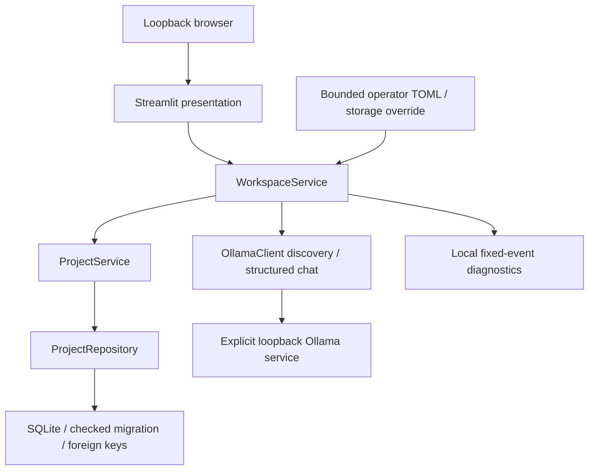
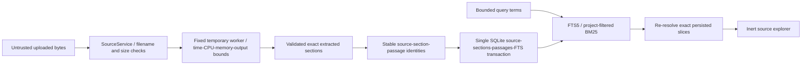

# Architecture — Phases 1–6

The core operates through ordinary Python services without Streamlit imports. `ui/app.py` owns presentation and ephemeral widget state; project data and model preference persist through services. No agent framework, web service, cloud SDK, vector database or queue is used.

`core/models.py` supplies Pydantic v2 contracts for projects, editorial goals and future evidence/editorial entities. Contracts do not implement ingestion or verification. `storage/migrations.py` establishes checked schemas 1–5; `storage/database.py` applies pending migrations transactionally, verifies the checksum/version on reopen, and refuses unknown schemas. `storage/repositories.py` parameterizes SQL. Project edits use a captured version in the UPDATE predicate; conflicting sessions cannot silently overwrite edits.

SQLite connections are short-lived, foreign keys enabled on every connection, and multi-record changes use transactions. There is no automatic deletion, source-file access or startup network call. The engine accepts a trusted operator storage directory, not a path from a source or model. The database name is fixed and symlink database targets are rejected. Do not treat this as protection against a malicious process running as the same OS user.

Model discovery uses fixed `/api/tags` and `/api/show` routes. Catalog candidates marked remote are filtered; selection rechecks metadata and rejects cloud-backed entries. Data are bounded, validated and displayed as text. Phase 1 never invokes inference, pulls models or fetches source URLs. The optional integration test checks discovery only.

All workflows preserve these service boundaries. Phase 2 source hashes and passage identities are deterministic over validated extraction inputs and exact extracted slices. Editing claim meaning must create a new revision and invalidate assessment in Phase 5; Phase 5 implements that behavior. Exports must preserve unresolved warnings and be escaped, deterministic and confined to trusted output locations in Phase 6.

## Phase 2 source path

`SourceService` validates upload names and metadata, invokes the fixed parser worker, derives identities/chunks, and publishes through `SourceRepository`. The worker receives bounded byte files in an application-generated temporary directory; it has no database or Streamlit access. `ingestion/parsers.py` extracts five formats without fetching URLs or rendering HTML. `ingestion/chunker.py` preserves section/page boundaries and exact slices. `ui/source_views.py` only presents import results, metadata and stored/search passages through services.

`subprocess` is allowed only in the parser launcher, with application-owned command arguments. Worker parsing never starts a model, executes document instructions or fetches a source URL. Parser process containment is not a full OS sandbox; details are in [ingestion](INGESTION.md) and [security](SECURITY.md).

## Phase 3 transformation path

`GenerationService` retrieves project-scoped FTS evidence, preserves whole passages inside a conservative prompt budget, loads one application-owned versioned template and builds separate system instructions / JSON preference-and-evidence messages. A distinct JSON schema constrains each format's ordered section kinds. Audience profiles change writing treatment while the system requires preserved meaning and material qualifications; semantic fidelity is not automatically verified.

`OllamaClient` rechecks installed/local model metadata and context, then posts only to loopback `/api/chat` with schema format, non-streaming responses, thinking disabled, fixed temperature/seed and explicit context/output limits. It bounds response bytes and read time, rejects incomplete responses, and never retries, downloads models or calls tools. `GenerationService` validates structure and aliases, re-resolves supplied passages, and persists an unreviewed draft through `DraftRepository`. `ui/studio.py` presents text and application-resolved evidence. The initial revision is persisted; Phase 5 adds human editing and section regeneration.

## Phase 4 verification path

`verification/extraction.py` derives exact prose-block claim candidates and revision/text fingerprints without model rewriting. `VerificationService` reopens canonical drafts/evidence, initializes legacy ledgers, retrieves additional project-scoped sources, packs bounded evidence and invokes the existing local Ollama client with `verification/prompts.py`. Typed replies allow only automated categories and exact quoted aliases. Deterministic category/reference checks run before `VerificationRepository` publishes current claims, evidence links and versioned assessment history in one optimistic transaction. New draft creation initializes its ledger within its existing transaction. `ui/evidence_review.py` contains presentation only and renders all dynamic prose/excerpts as inert text.

No support score or human verification is inferred from retrieval or citation presence. Every result remains pending human review. Canonical revision mismatch stops inspection/reuse of older assessments; Phase 5 adds revision editing and human decisions.

## Phase 5 editorial path

`EditorialService` orchestrates validated complete-document manual edits, explicit human decisions, revision/history reads and local one-section generation. `EditorialRepository` appends revision/ledger/head/event records transactionally and compares the current head or claim version. `generation.reopen` and `verification.ledger/assess` accept explicit revision IDs to keep historical review separate. All revisions receive fresh claim identities and pending statuses. The model cannot call human-decision APIs or modify other sections; existing source aliases are preserved across regeneration.

`ui/editorial.py` provides revision selection and section forms; Evidence Review adds explicit reviewer/rationale/source selection, confirmation and history. The app records self-reported local editorial decisions, without authenticating reviewer identity or independently verifying truth. Export remains Phase 6.

## Phase 6 export path

`ExportService` captures the selected immutable revision and versioned current claim ledger, reads its audit history in a checked database snapshot and resolves exact historical/current evidence. It returns bounded `ExportFile` bytes with UUID-derived names. `exporting/renderers.py` provides deterministic escaped Markdown, fixed autoescaped Jinja2 HTML/CSP, editable inactive OOXML and an exact JSON manifest. `ui/exports.py` prepares local downloads and invalidates cached outputs when observed review versions change. Export never changes status or accepts a source/model-derived output path. No schema change was needed beyond schema 5.
